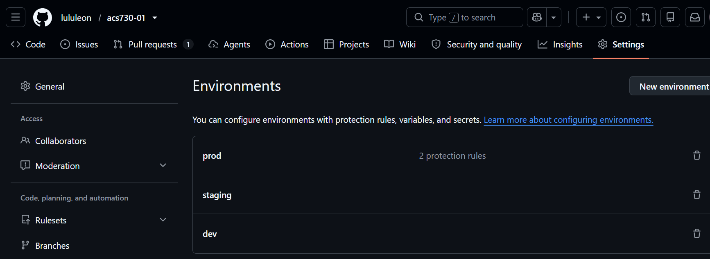

# Assignment 1

# capture environments.json
Create envs in gh:

After creating envs in github, needed `gh api repos/lululeon/acs730-01/environments/prod/deployment-branch-policies`. Saved [here](./evidence/environments.json).
