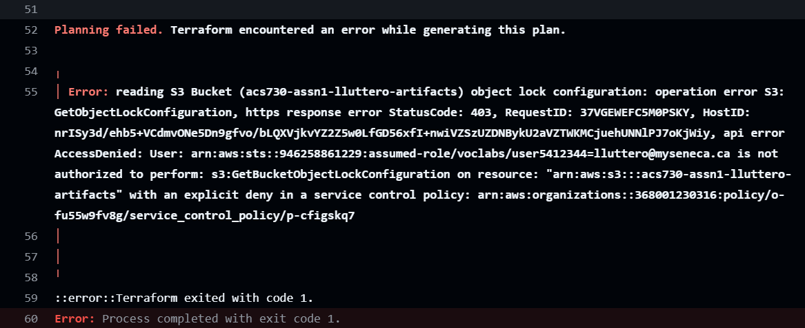
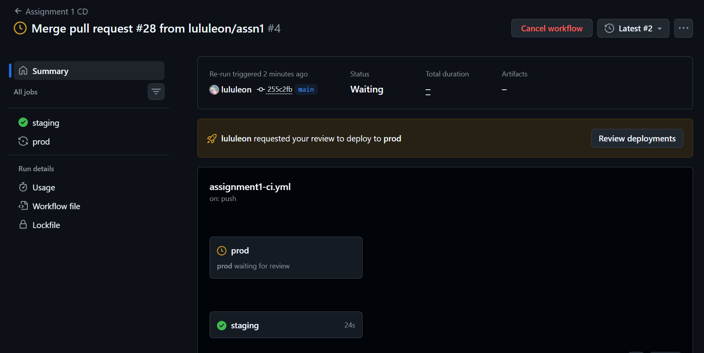

# Assignment 1

# capture environments.json
Create envs in gh:

After creating envs in github, needed `gh api repos/lululeon/acs730-01/environments/prod/deployment-branch-policies`. Saved [here](./evidence/environments.json).

# fix staging pipeline:
Getting this error:

Need to run `terraform state rm 'module.web.aws_s3_bucket.artifacts'`

Then had to cancel the workflow, and then rerun. Staging now completes, and prod waits for manual intervention:


# moving the secrets:
- used: `./scripts/refresh-gha-creds.sh lululeon/acs730-01 staging prod`
- then deleted **repo-level** vars: `gh api repos/lululeon/acs730-01/actions/secrets` returns:
```json
{
  "total_count": 0,
  "secrets": []
}
```

Used this for secrets-scope.txt:
```sh
gh secret list --repo lululeon/acs730-01 > assignment1/evidence/secrets-scope.txt
echo "=== staging ===" >> assignment1/evidence/secrets-scope.txt
gh secret list --repo lululeon/acs730-01 --env staging >> assignment1/evidence/secrets-scope.txt
echo "=== prod ===" >> assignment1/evidence/secrets-scope.txt
gh secret list --repo lululeon/acs730-01 --env prod >> assignment1/evidence/secrets-scope.txt
```