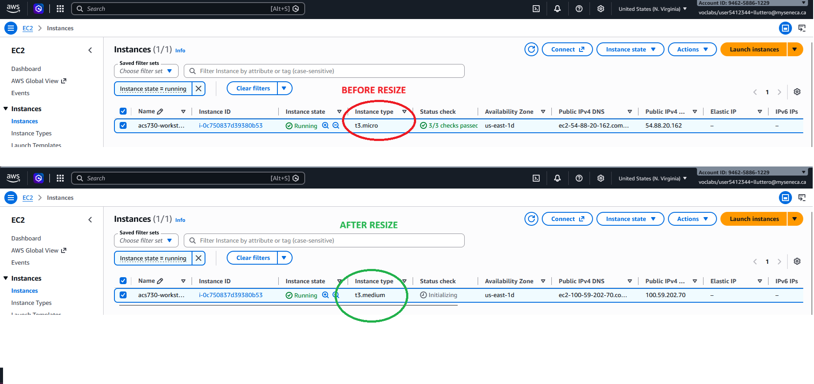
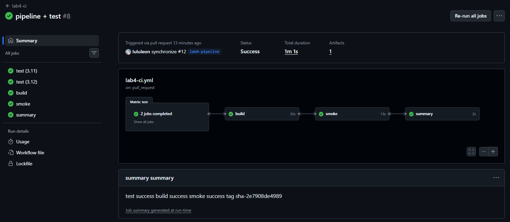
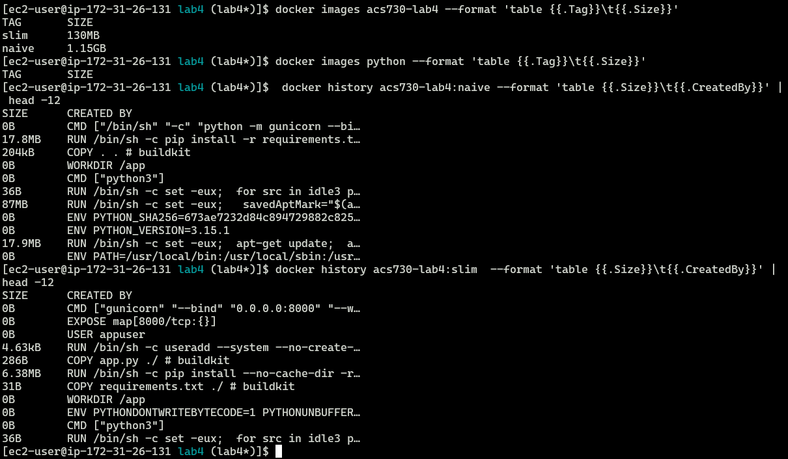

# Lab 4

## Instance size update




## Summary of Builds

| Image  | Base Image           | Size   | Rebuild Time (after one-line code change) |
|--------|----------------------|--------|-------------------------------------------|
| naive  | python:3.15.1        | 1.15GB | 4s                                        |
| slim   | python:3.12-slim-bookworm | 130MB | 0.7s                                 |

- **SIZE DIFFs**: `python:latest` versus `python:3.12-slim-bookworm`, adds ~1Gb extra. The pip layers differ by ~11 MB (17.8 MB versus 6.38 MB).
- **REBUILD**: The naive image copies the whole context over, just before `pip install`, but the one-line change to app.py changes what was copied earlier, so that that layer has to be rebuilt, **plus all the layers that came after** including the pip install.
- **DOCKERIGNORE**: `.dockerignore` kept `.git`, `.github`, `__pycache__`, `.pyc`, `.pytest_cache`, `evidence/`, other `*.png` and `*.md` files, and the Dockerfiles themselves out of the slim build context (474 B sent, versus 205 kB on the naive rebuild).


---

# Part 2 - Pipeline updates

Pipeline screenshot showing pass => intentional fail => pass:


### CI Graph



--- 
## Investigations / personal notes

<details>
<summary>Comparison of the two docker images</summary>

<details>
<summary>raw output</summary>

```
[ec2-user@ip-172-31-26-131 lab4 (lab4*)]$ time docker build -f Dockerfile.naive -t acs730-lab4:naive .
[+] Building 28.4s (9/9) FINISHED                                                                        docker:default
 => [internal] load build definition from Dockerfile.naive                                                         0.0s
 => => transferring dockerfile: 307B                                                                               0.0s
 => [internal] load metadata for docker.io/library/python:latest                                                   0.5s
 => [internal] load .dockerignore                                                                                  0.0s
 => => transferring context: 2B                                                                                    0.0s
 => [1/4] FROM docker.io/library/python:latest@sha256:67ee282bdbe5ece1e38ea94fa68f1420e969e6176e6c826b9acc931055  22.1s
 => => resolve docker.io/library/python:latest@sha256:67ee282bdbe5ece1e38ea94fa68f1420e969e6176e6c826b9acc9310550  0.0s
 => => sha256:2e13bb9164213e8dec5adf78bc63bb710054c4b656800e29a25f756ed2fa18ae 2.32kB / 2.32kB                     0.0s
 => => sha256:63040bd9752a74c5b1082903de92d441d30121f994018576b4a2f4cf8bb3bca4 25.64MB / 25.64MB                   0.4s
 => => sha256:7046f4e749f0e32d9fc67f654ad5e33cc555534f82a9971e45a00dbdb899e309 67.82MB / 67.82MB                   1.0s
 => => sha256:67ee282bdbe5ece1e38ea94fa68f1420e969e6176e6c826b9acc931055011bfb 10.95kB / 10.95kB                   0.0s
 => => sha256:967555bbc8c4caeaacc8053d8b876db7dbabd26a32cdcffaff745b42a93b0b26 6.48kB / 6.48kB                     0.0s
 => => sha256:8d0037029946d2c6dabce18eceda79c533c5797ed1ee86f94084cb8cddaeea91 49.39MB / 49.39MB                   0.8s
 => => sha256:992d9e06c2e85b99901bc1e8b27e557e9537e4d0eee8d4cdff13bc0f9bdee2e4 237.00MB / 237.00MB                 3.6s
 => => extracting sha256:8d0037029946d2c6dabce18eceda79c533c5797ed1ee86f94084cb8cddaeea91                          3.2s
 => => sha256:6f634d75d986092eb1b2e90be35fff04c7bd81a10ed7a6c037f65410f1c427e1 6.10MB / 6.10MB                     1.2s
 => => sha256:23346f0ec4f391e5f3c8bb60d5ddc548c8dad2f10778ead6a17d1481c3ea36b6 32.78MB / 32.78MB                   1.8s
 => => sha256:3c16dcb966e697ed3bd6e60d2f5c698364b018843202b9524a440b26883489a9 249B / 249B                         1.3s
 => => extracting sha256:63040bd9752a74c5b1082903de92d441d30121f994018576b4a2f4cf8bb3bca4                          0.9s
 => => extracting sha256:7046f4e749f0e32d9fc67f654ad5e33cc555534f82a9971e45a00dbdb899e309                          3.6s
 => => extracting sha256:992d9e06c2e85b99901bc1e8b27e557e9537e4d0eee8d4cdff13bc0f9bdee2e4                         10.9s
 => => extracting sha256:6f634d75d986092eb1b2e90be35fff04c7bd81a10ed7a6c037f65410f1c427e1                          0.4s
 => => extracting sha256:23346f0ec4f391e5f3c8bb60d5ddc548c8dad2f10778ead6a17d1481c3ea36b6                          1.4s
 => => extracting sha256:3c16dcb966e697ed3bd6e60d2f5c698364b018843202b9524a440b26883489a9                          0.0s
 => [internal] load build context                                                                                  0.0s
 => => transferring context: 1.24kB                                                                                0.0s
 => [2/4] WORKDIR /app                                                                                             1.1s
 => [3/4] COPY . .                                                                                                 0.0s
 => [4/4] RUN pip install -r requirements.txt                                                                      4.3s
 => exporting to image                                                                                             0.2s
 => => exporting layers                                                                                            0.2s
 => => writing image sha256:25bb5e7fe096db80501a14069a4bd8c4f1ca490e343714f2b2fd530179df1a18                       0.0s
 => => naming to docker.io/library/acs730-lab4:naive                                                               0.0s

real    0m28.537s
user    0m0.326s
sys     0m0.133s
[ec2-user@ip-172-31-26-131 lab4 (lab4*)]$
```
</details>

Time elapsed: 28s.

|TAG  |     SIZE|
|-----|---------|
|naive |    1.15GB|

### Build #2 after minor change

<details>
<summary>raw output</summary>

```
[ec2-user@ip-172-31-26-131 lab4 (lab4*)]$  sed -i 's/version /release /' app.py
[ec2-user@ip-172-31-26-131 lab4 (lab4*)]$ time docker build -f Dockerfile.naive -t acs730-lab4:naive .
[+] Building 4.6s (9/9) FINISHED                                                                         docker:default
 => [internal] load build definition from Dockerfile.naive                                                         0.0s
 => => transferring dockerfile: 307B                                                                               0.0s
 => [internal] load metadata for docker.io/library/python:latest                                                   0.2s
 => [internal] load .dockerignore                                                                                  0.0s
 => => transferring context: 2B                                                                                    0.0s
 => [1/4] FROM docker.io/library/python:latest@sha256:67ee282bdbe5ece1e38ea94fa68f1420e969e6176e6c826b9acc9310550  0.0s
 => [internal] load build context                                                                                  0.0s
 => => transferring context: 204.72kB                                                                              0.0s
 => CACHED [2/4] WORKDIR /app                                                                                      0.0s
 => [3/4] COPY . .                                                                                                 0.0s
 => [4/4] RUN pip install -r requirements.txt                                                                      4.2s
 => exporting to image                                                                                             0.2s
 => => exporting layers                                                                                            0.2s
 => => writing image sha256:1fc55b1ff7d3cc5f57865670e6dbb907e684cd8a8da8b3cb1eee7a0875d66241                       0.0s
 => => naming to docker.io/library/acs730-lab4:naive                                                               0.0s

real    0m4.801s
user    0m0.186s
sys     0m0.069s
[ec2-user@ip-172-31-26-131 lab4 (lab4*)]$
```
</details>

Time elapsed: 4s.


### Correct Build

<details>
<summary>raw output</summary>

```
[ec2-user@ip-172-31-26-131 lab4 (lab4*)]$  time docker build -t acs730-lab4:slim .
[+] Building 8.2s (11/11) FINISHED                                                                       docker:default
 => [internal] load build definition from Dockerfile                                                               0.0s
 => => transferring dockerfile: 646B                                                                               0.0s
 => [internal] load metadata for docker.io/library/python:3.12-slim-bookworm                                       0.3s
 => [internal] load .dockerignore                                                                                  0.0s
 => => transferring context: 181B                                                                                  0.0s
 => [1/6] FROM docker.io/library/python:3.12-slim-bookworm@sha256:6a0e06f5ba0b373d051aabd3fffb9b873f27f9a2a3a14bc  3.4s
 => => resolve docker.io/library/python:3.12-slim-bookworm@sha256:6a0e06f5ba0b373d051aabd3fffb9b873f27f9a2a3a14bc  0.0s
 => => sha256:87463122edacdc60df8c7840549960acce4dfb91a2b2aa36f563f62e0cd991db 13.68MB / 13.68MB                   0.2s
 => => sha256:6a0e06f5ba0b373d051aabd3fffb9b873f27f9a2a3a14bcbe37dee6f0e3bbc70 6.55kB / 6.55kB                     0.0s
 => => sha256:57d96f71de145a98e7ceca18ee4ade77bba4103a33a72dfaea026b23625c6bf0 1.75kB / 1.75kB                     0.0s
 => => sha256:3c4d812a6efe003770aafbdba65f9c1960ba8234ab23a133934205a70bdcda77 5.68kB / 5.68kB                     0.0s
 => => sha256:11422d7ca1a44390a32bd8d8d9dc5946b4d053b3bbd9507d682e35584ba84a26 28.25MB / 28.25MB                   0.3s
 => => sha256:fd4548892b7d74acf5f52391380b45441b4ec55f6c2e1506030c2af26fd3e3f6 3.34MB / 3.34MB                     0.2s
 => => sha256:b52d28f2ade3944bb78458d2d77f25816d73cb5566d86dd897c9b8829a853ad8 249B / 249B                         0.2s
 => => extracting sha256:11422d7ca1a44390a32bd8d8d9dc5946b4d053b3bbd9507d682e35584ba84a26                          1.8s
 => => extracting sha256:fd4548892b7d74acf5f52391380b45441b4ec55f6c2e1506030c2af26fd3e3f6                          0.2s
 => => extracting sha256:87463122edacdc60df8c7840549960acce4dfb91a2b2aa36f563f62e0cd991db                          0.9s
 => => extracting sha256:b52d28f2ade3944bb78458d2d77f25816d73cb5566d86dd897c9b8829a853ad8                          0.0s
 => [internal] load build context                                                                                  0.0s
 => => transferring context: 474B                                                                                  0.0s
 => [2/6] WORKDIR /app                                                                                             0.2s
 => [3/6] COPY requirements.txt ./                                                                                 0.0s
 => [4/6] RUN pip install --no-cache-dir -r requirements.txt                                                       3.5s
 => [5/6] COPY app.py ./                                                                                           0.1s
 => [6/6] RUN useradd --system --no-create-home --uid 10001 appuser  && chown -R appuser:appuser /app              0.4s
 => exporting to image                                                                                             0.1s
 => => exporting layers                                                                                            0.1s
 => => writing image sha256:1bf4c953899e6b71af4c918729d39091a4ea83ee420b689f248512d77dbb1da1                       0.0s
 => => naming to docker.io/library/acs730-lab4:slim                                                                0.0s

real    0m8.373s
user    0m0.152s
sys     0m0.126s
[ec2-user@ip-172-31-26-131 lab4 (lab4*)]$
```
</details>

Elapsed time: 8s

### After minor change

<details>
<summary>raw output</summary>

```
[ec2-user@ip-172-31-26-131 lab4 (lab4*)]$ sed -i 's/version /release /' app.py
[ec2-user@ip-172-31-26-131 lab4 (lab4*)]$  time docker build -t acs730-lab4:slim .
[+] Building 0.6s (11/11) FINISHED                                                                       docker:default
 => [internal] load build definition from Dockerfile                                                               0.0s
 => => transferring dockerfile: 646B                                                                               0.0s
 => [internal] load metadata for docker.io/library/python:3.12-slim-bookworm                                       0.2s
 => [internal] load .dockerignore                                                                                  0.0s
 => => transferring context: 181B                                                                                  0.0s
 => [1/6] FROM docker.io/library/python:3.12-slim-bookworm@sha256:6a0e06f5ba0b373d051aabd3fffb9b873f27f9a2a3a14bc  0.0s
 => [internal] load build context                                                                                  0.0s
 => => transferring context: 474B                                                                                  0.0s
 => CACHED [2/6] WORKDIR /app                                                                                      0.0s
 => CACHED [3/6] COPY requirements.txt ./                                                                          0.0s
 => CACHED [4/6] RUN pip install --no-cache-dir -r requirements.txt                                                0.0s
 => [5/6] COPY app.py ./                                                                                           0.0s
 => [6/6] RUN useradd --system --no-create-home --uid 10001 appuser  && chown -R appuser:appuser /app              0.3s
 => exporting to image                                                                                             0.1s
 => => exporting layers                                                                                            0.0s
 => => writing image sha256:fe8235496c72b9f9c58ff27773248141a5b95ce90a8884422195a9744064f15c                       0.0s
 => => naming to docker.io/library/acs730-lab4:slim                                                                0.0s

real    0m0.782s
user    0m0.167s
sys     0m0.048s
[ec2-user@ip-172-31-26-131 lab4 (lab4*)]$
```
</details>

Elapsed time: 0.7s !!

# Image sizes comparison

The reports showed the following

<details>
<summary>Raw output</summary>

```
[ec2-user@ip-172-31-26-131 lab4 (lab4*)]$ docker images acs730-lab4 --format 'table {{.Tag}}\t{{.Size}}'
TAG       SIZE
slim      130MB
naive     1.15GB
[ec2-user@ip-172-31-26-131 lab4 (lab4*)]$ docker images python --format 'table {{.Tag}}\t{{.Size}}'
TAG       SIZE
[ec2-user@ip-172-31-26-131 lab4 (lab4*)]$  docker history acs730-lab4:naive --format 'table {{.Size}}\t{{.CreatedBy}}' | head -12
SIZE      CREATED BY
0B        CMD ["/bin/sh" "-c" "python -m gunicorn --bi…
17.8MB    RUN /bin/sh -c pip install -r requirements.t…
204kB     COPY . . # buildkit
0B        WORKDIR /app
0B        CMD ["python3"]
36B       RUN /bin/sh -c set -eux;  for src in idle3 p…
87MB      RUN /bin/sh -c set -eux;   savedAptMark="$(a…
0B        ENV PYTHON_SHA256=673ae7232d84c894729882c825…
0B        ENV PYTHON_VERSION=3.15.1
17.9MB    RUN /bin/sh -c set -eux;  apt-get update;  a…
0B        ENV PATH=/usr/local/bin:/usr/local/sbin:/usr…
[ec2-user@ip-172-31-26-131 lab4 (lab4*)]$ docker history acs730-lab4:slim  --format 'table {{.Size}}\t{{.CreatedBy}}' | head -12
SIZE      CREATED BY
0B        CMD ["gunicorn" "--bind" "0.0.0.0:8000" "--w…
0B        EXPOSE map[8000/tcp:{}]
0B        USER appuser
4.63kB    RUN /bin/sh -c useradd --system --no-create-…
286B      COPY app.py ./ # buildkit
6.38MB    RUN /bin/sh -c pip install --no-cache-dir -r…
31B       COPY requirements.txt ./ # buildkit
0B        WORKDIR /app
0B        ENV PYTHONDONTWRITEBYTECODE=1 PYTHONUNBUFFER…
0B        CMD ["python3"]
36B       RUN /bin/sh -c set -eux;  for src in idle3 p…
[ec2-user@ip-172-31-26-131 lab4 (lab4*)]$
```
</details>



The size impacts for the naive build are from the initial 12 lines of history: 
- `17.8MB    RUN /bin/sh -c pip install -r requirements.t…` : the **pip install** command
- `87MB      RUN /bin/sh -c set -eux;   savedAptMark="$(a…` : seemingly from indirect **apt** behavior
- `17.9MB    RUN /bin/sh -c set -eux;  apt-get update;  a…` : more **apt** impace (`apt-get update` specifically)

So it initially seems like download packages and related cacheing bloated the size of the naive build, and there was no opportunity to filter these out via the `.dockerignore` file that was introduced later for the slim build.

In contrast for the slim build, **pip install** impacts on the build were constrained at the outset via a `PYTHONDONTWRITEBYTECODE=1`, which:
  > prevents Python from writing .pyc bytecode and pycache directories to disk, keeping builds and containers cleaner

(:bulb: it turns out that the other setting, `PYTHONUNBUFFERED=1` is more for observability than anything: it stops python from hogging memory with buffered writes to stdout and stderr; if writes immediately to your container logs so you can see what is happening in realtime - useful if there are errors/failures etc).

Lastly, the `FROM` directives in the dockerfiles are different. The history command given in the lab used `head -12` so we don't see the impacts of the first few layers. Here's what we see from the full history outputs: 

**naive build, bottom-most layers:**
The naive build simply uses `python:latest`:
```
657MB     RUN /bin/sh -c set -ex;  apt-get update;  ap…
185MB     RUN /bin/sh -c set -eux;  apt-get update;  a…
60.2MB    RUN /bin/sh -c set -eux;  apt-get update;  a…
120MB     # debian.sh --arch 'amd64' out/ 'trixie' '@1…
```
**slim build, bottom-most layers:**
The Slim build uses `python:3.12-slim-bookworm`, with a much smaller footprint:
```
8.52MB    RUN /bin/sh -c set -eux;  apt-get update;  a…
0B        ENV LANG=C.UTF-8
0B        ENV PATH=/usr/local/bin:/usr/local/sbin:/usr…
74.9MB    # debian.sh --arch 'amd64' out/ 'bookworm' '…
```

The contrast is clear here: the choice of python image and the underlying linux image also contributed massively to why the naive build was bigger and slower.
</details>
