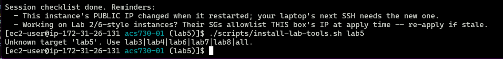
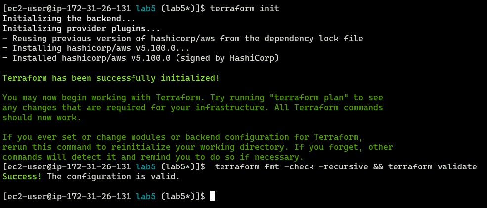
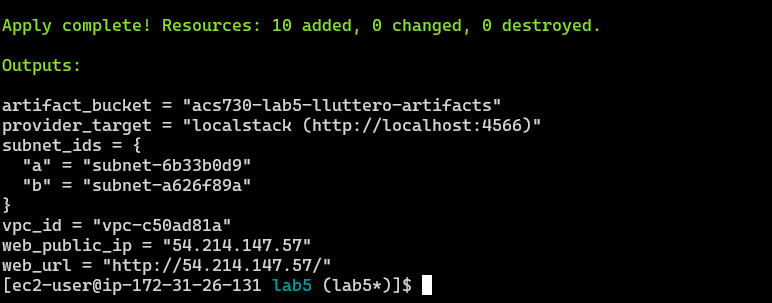
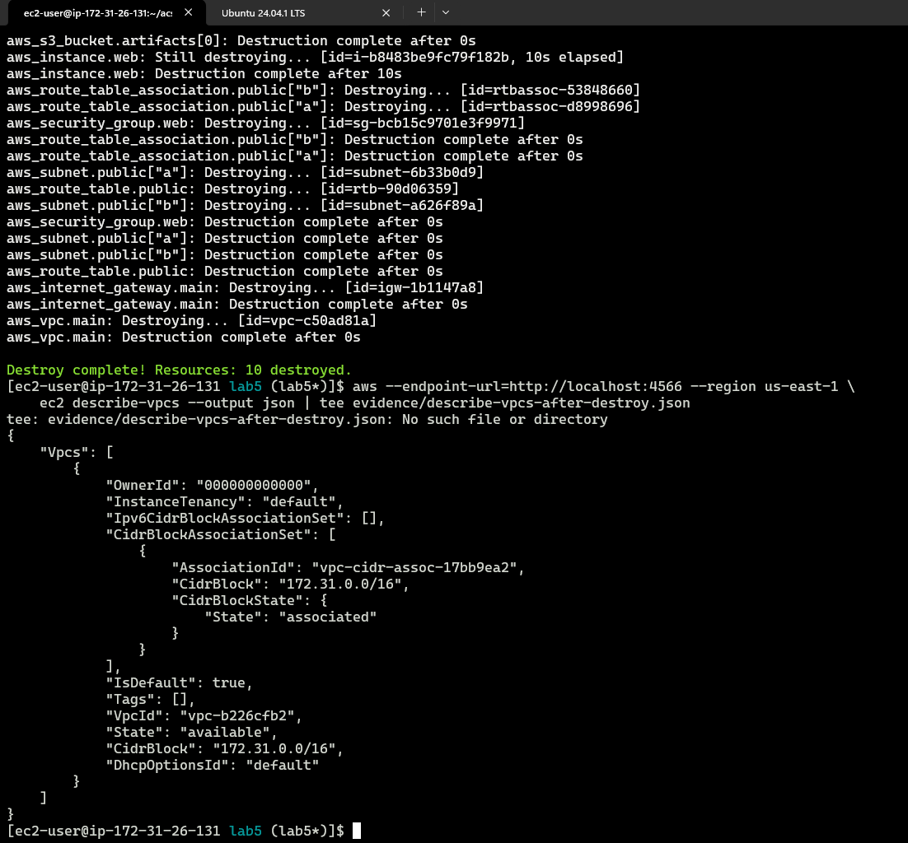
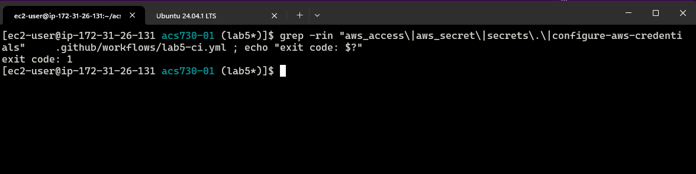

# Lab 5

## Why for_each here and count there

This question did not immediately make sense. An LLM made sense of it as follows:
>  why the subnets use for_each and the artifact bucket uses count.

In that case:
- since we defined a map which has keys that are "stable shortnames" for subnets, we have a 1:1 mapping between those keys and the subnets we want to build with terraform. So "for each" shortname, build a subnet. Hence the usage of `for_each`.

- The usage of `count` for the artifact bucket will determine how many of a resource we build. Since we used
  ```tf
  count = var.create_artifact_bucket ? 1 : 0
  ```
  we are saying that if the create flag is set, we build the (one) s3 bucket. Otherwise we would build zero (no s3 bucket created).

## Screenshots

<details>
<summary>screenshots</summary>











</details>
