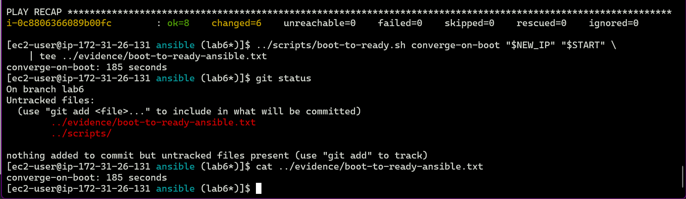
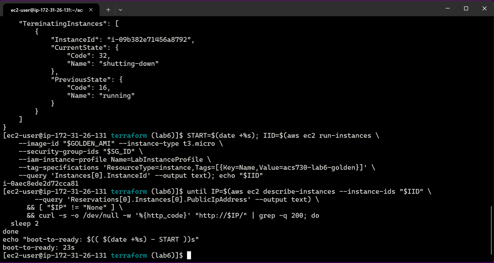
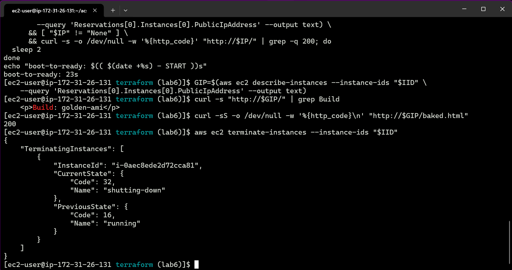
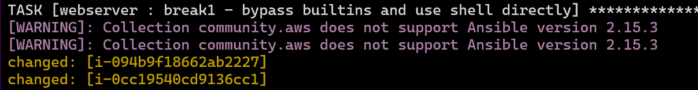
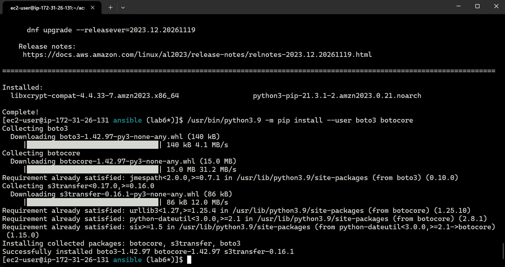
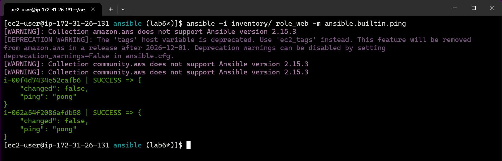
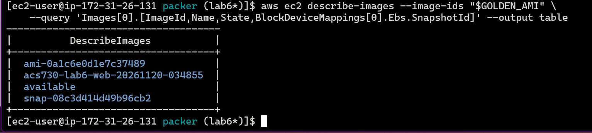
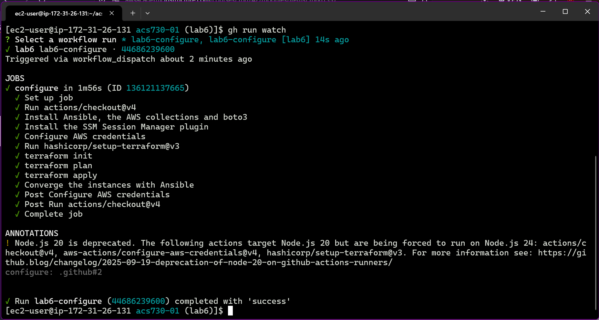

# Lab 6

## runner-to-instance mechanism
Not clear initially what was meant by this. An AI analysis of the lab text determined:
> runner-to-instance mechanism refers to how the machine running Ansible in GitHub Actions gets a connection to the EC2 instances

This would be via Session Manager - no ingress into the target host is needed (or configured) and there is no ssh key available either.

## changed=0 meaning
This means no resources to change; basically this run is idempotent with the last run (the playbook is idempotent).

## why why deregistering an AMI is not enough
The AMI will be gone but the EBS that holds the machine image will still be there and billed to your account. The EBS snaphot itself needs to be additionally removed. **you need to grab the snapshot ID BEFORE nuking the ami** otherwise it becomes very difficult to determine.: `aws ec2 describe-images --image-ids "$GOLDEN_AMI"`

## Boot times
| method | time | tasks |
|---------|-------------|------------|
|tf apply + ansible converge | 185s| likely instance launch, SSM agent registration, dnf downloads, service start. :warning: The launch time was not recorded separately. :/|
| tf deploy golden image| 23s | instance launch, SSM agent registration |

**Qualitatively**, the golden ami was much faster but the timing of the first part likely covered more things or overran, so cannot quantify accurately. It seemed at the time that the ansible playbook took the most time, so I would put the dnf (package downloads) tasks as the most expensive.

  - boot to ready with apply then converge: 185s
  

  - boot to ready time with golden ami: 23s
    - 
    - 


## The cost a golden AMI moves rather than removes.
It moves the convergence steps upstream / earlier in the workflow so that they are done once, before instances are created.

## What breaks with golden AMIs
While you get faster launches, you also get faster obsolescence in terms of outdated versions, patches etc. Also makes the image a "black box" whereas a playbook allows you to see what goes into the image.

## What breaks with converge-on-boot
Reliability of the pipeline (e.g. if package mirrors / internet etc is not available, the pipeline hangs or fails).

## Your recommendation, in one sentence
Golden AMIs when there are a large number of settings that don't change often and a large number of hosts that will be created in the same way.

## SSM bucket-and-region constraint from Part 2
Unclear what this is asking for. AI analysis yields:

> Session Manager transfers files through an S3 bucket, acs730-lab6-ssm-<account>, which must be in us-east-1. ansible_aws_ssm_region must also be us-east-1 and match the bucket. If they disagree, the first task fails with PermanentRedirect.

## Experiments
Setup: All infra was destroyed after lab so will rebuild first, then:

Experiment 1:
- **action**: run a shell-based command:
  ```yml
  - name: break1 - bypass builtins and use shell directly
    ansible.builtin.shell: mkdir -p /opt/acs730-web/logs
  ```
- **predicted**:
  - **1st run** will report `changed=1` changed.
  - **2nd run** will still report `changed=1` change because it won't detect the existence of the folder (because the shell builtin will not check first)... it will succeed regardless because of the `-p`.
  - **3rd run (undo the edit)**: will report `1` changed since the command is gone, but i don't think it will result in the folder being removed necessarily.
- **actual**
  - first, make sure baseline resources are there for ansible:
    ```
    i-0cc19540cd9136cc1 | SUCCESS => {
        "changed": false,
        "ping": "pong"
    }
    i-094b9f18662ab2227 | SUCCESS => {
        "changed": false,
        "ping": "pong"
    }
    [ec2-user@ip-172-31-26-131 ansible (main)]$
    ```
  - run ansible on new-ly deployed servers (baseline): ` ok=8    changed=6`
  - run updated ansible:
     1st run: ✅ `ok=8    changed=1`
  - 2nd run: same ✅ `ok=8    changed=1`

  Expectations matched actuality.
  Teardown: remove ansible change, replay.


---

# Other Notes
- pip install was needed as was boto3. fix:
  

- ansible able to reach hosts:
  

- golden ami:
  

- pipeline run:
  

- modified query to get the SG (AI):
  ```sh
   SG_ID=$(aws ec2 describe-security-groups --filters Name=group-name,Values=acs730-lab6-sg \
    --query 'SecurityGroups[0].GroupId' --output text)
  [[ $SG_ID =~ ^sg-[0-9a-f]+$ ]] && echo "ok: $SG_ID" || echo "bad: $SG_ID"
  ```
  Due to drift between manual run from ec2 workstation vs manual GA pipeline run not sharing state. Also after launching, realized elapsed time includes all the mistakes and recoveries so had to redo:
  - `aws ec2 terminate-instances --instance-ids "$IID"`
  - the redo the timed run steps: `START=$(date +%s)`, `IID=$(...)`.

# Remedy for destroy
Recipe from LLM:
```sh
# 1. Find the instances the pipeline created
aws ec2 describe-instances \
    --filters Name=tag:Lab,Values=lab6 Name=tag:Role,Values=web \
              Name=instance-state-name,Values=pending,running,stopped \
    --query 'Reservations[].Instances[].[InstanceId,Tags[?Key==`Name`]|[0].Value,State.Name]' \
    --output text

# 2. Import them (use your real instance IDs; SG_ID is the one you already have)
terraform import aws_security_group.web "$SG_ID"
terraform import 'aws_instance.web[0]' i-XXXXXXXX     # acs730-lab6-web-0
terraform import 'aws_instance.web[1]' i-YYYYYYYY     # acs730-lab6-web-1

# 3. Confirm what it will remove, then destroy and record it
terraform state list
terraform destroy -auto-approve 2>&1 | tee ~/teardown.txt
```

## Other points raised in lab:

### No runner address anywhere in the workflow
They don't normally address the runner; not sure why this workflow would be any different. Each run is a fresh vm and the workflow only says what type of runner it wants (`runs-on: ubuntu-latest`).

### The tooling goes in near the top, not between apply and converge.
We don't want the newly provisioned infrastructure hanging around for too long before convergence; that would be an opportunity for out of band changes (someone else running an apply, manual edits that could introduce changes etc): these could change expected conditions found by ansible and ultimately change what convergence does. This in turn can destroy idempotency. 

It's best to prevent that by running convergence as soon as possible after apply.

### session-manager-plugin is installed explicitly
The runner does not have software / plugins installed locally and it also does not have anything available in aws. So all needed tools must be explicitly installed.

### The retry loop before the playbook
This emulates what was done locally to allow hosts time to bootup and connect with SSM Manager before going any further (otherwise the convergence step can fail)
