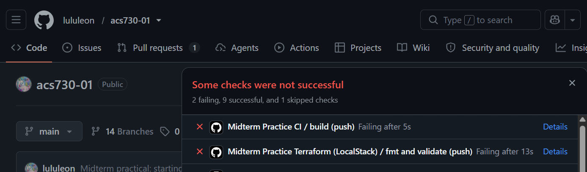
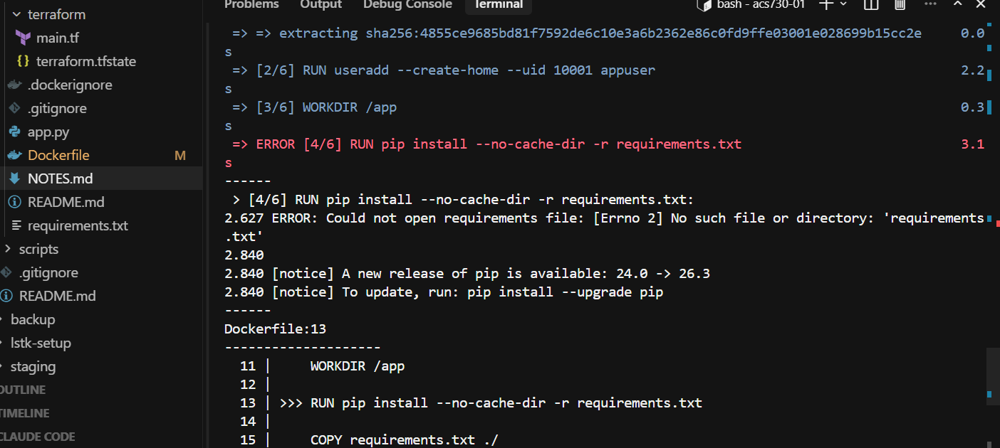
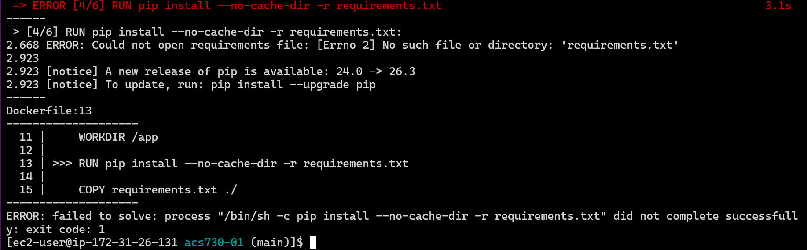
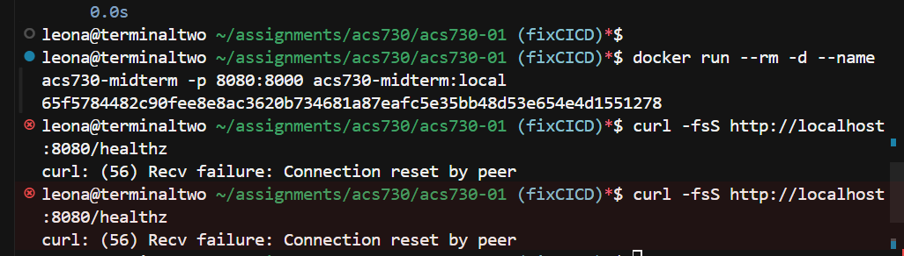
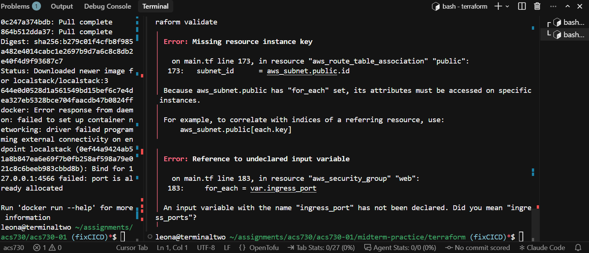
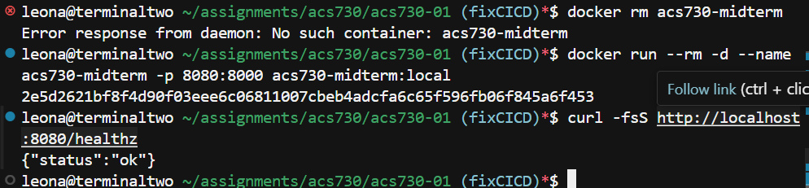
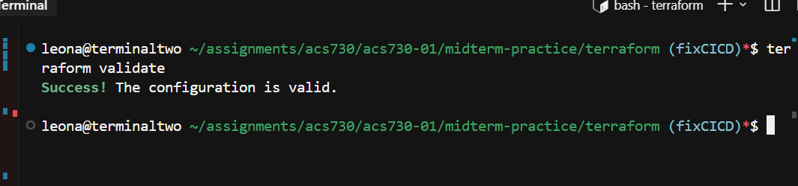

# Midterm Practice -- Notes

Initial failures:

Switched to working locally

## Local Build fails:

## Fixes implemented:
- update dockerfile to get requirements first.
- fix the bind port
- fix correct use of foreach key: `aws_subnet.public[each.key].id`
- similar fix for ingress ports: plurality: `for_each = var.ingress_ports`

fixed healthcheck

fixed tf validate

## Task 5: git hygiene

<!-- Replace this line with one sentence explaining why deleting the .tfstate
     file and the credential string in your latest commit is not sufficient
     by itself. -->

TODO
